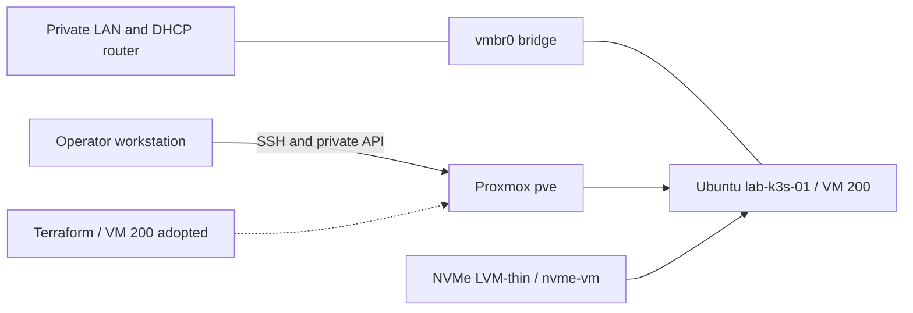

# Enterprise Platform Lab

A practical platform engineering lab built on a single Proxmox host. The project establishes a verified Ubuntu foundation, then progresses toward infrastructure as code, Kubernetes, GitOps, and observable application delivery.

## Objectives

- Maintain reproducible infrastructure configuration and operational documentation.
- Adopt the existing VM into Terraform without replacing infrastructure.
- Build a single-node K3s platform and progressively introduce GitOps, observability, and security controls.

## Current status

Verified on **2026-10-25** using Proxmox, guest SSH, a Terraform import-only apply, a zero-change plan, and repository checks.

| Component | Status |
| --- | --- |
| Proxmox VE 9.2.21, node `pve` | Operational |
| Ubuntu `lab-k3s-01`, VMID 200 | Running; cloud-init completed |
| VM resources | 2 vCPU, 3072 MiB RAM, 40 GiB disk on `nvme-vm` |
| Guest OS | Ubuntu 24.04.5 LTS |
| Guest network | DHCP, observed `192.168.10.226/24` |
| SSH | Public-key login verified; password authentication disabled |
| Terraform | VM 200 imported; zero-change plan verified |
| K3s | v1.36.5+k3s1; node Ready; DNS, ingress, and reboot recovery verified |
| GitOps / observability stack | Planned; controllers and heavyweight monitoring not installed |

All addresses shown are **private LAN addresses**, not publicly reachable service endpoints. Access requires the lab LAN or an independently configured trusted access path. The DHCP address can change.

## Architecture and stack



The host uses an Intel Core i5-6500T, approximately 8 GiB RAM, a SATA system SSD, and a separate NVMe VM datastore. The current toolchain is Terraform 1.17.0 with bpg/proxmox 0.118.0, Proxmox CLI, OpenSSH, and Ubuntu cloud-init. K3s uses SQLite, containerd, Flannel, CoreDNS, Traefik, and ServiceLB. GitOps remains planned.

## Quick start

These commands inspect the existing lab; they do not provision infrastructure.

```sh
git status --short
terraform -chdir=terraform/environments/lab fmt -check
terraform -chdir=terraform/environments/lab validate
terraform -chdir=terraform/environments/lab state list
ssh proxmox-lab 'qm status 200'
```

For a fresh checkout, install a supported Terraform version and run `terraform -chdir=terraform/environments/lab init -lockfile=readonly` before validation. Validation requires the operator public-key file referenced by `ssh_public_key_path`; override that variable with your own public-key path where necessary. Do not copy private keys into the repository.

After verifying the guest host key through a trusted channel:

```sh
ssh -o StrictHostKeyChecking=yes -o IdentitiesOnly=yes \
  -i ~/.ssh/id_ed25519_proxmox ubuntu@192.168.10.226
```

The key path and SSH alias are operator-local prerequisites, not files distributed with this repository. Follow the [management access instructions](docs/02-proxmox-setup.md) and [guest verification procedures](docs/04-ubuntu-vm.md).

**VM 200 was provisioned with Proxmox CLI and subsequently adopted by Terraform.** Local state now contains the node data source and VM resource. The import changed no infrastructure, and a fresh plan reports no changes. See the [adoption results](docs/03-terraform.md). State remains local and must be backed up securely; a fresh checkout does not include it.

## Documentation

1. [Architecture and decisions](docs/01-architecture.md)
2. [Proxmox setup and access](docs/02-proxmox-setup.md)
3. [Terraform workflow and image management](docs/03-terraform.md)
4. [Ubuntu VM configuration and verification](docs/04-ubuntu-vm.md)
5. [Security posture and improvements](docs/05-security.md)
6. [Roadmap and acceptance criteria](docs/06-roadmap.md)
7. [K3s installation, validation, and operations](docs/07-k3s.md)

## Operational boundaries

Never run `terraform destroy`, delete existing infrastructure, or change Proxmox host networking, storage configuration, or authentication without explicit authorization. Additional VMs and destructive operations require explicit approval. Keep state, plans, credentials, and private keys outside Git. Repository publication must remain private unless explicitly approved otherwise.

## Adoption completed — 2026-10-25

The reviewed import-only plan adopted VM 200 with zero additions, changes, or deletions. A follow-up plan returned no changes. The VM remained running and reachable with no pending configuration changes. K3s was subsequently installed and validated; see the K3s milestone below.

## K3s installed — 2026-10-25

The existing VM now runs pinned K3s `v1.36.5+k3s1` with embedded SQLite and the default lightweight packaged components. Node Ready, API health, internal/external DNS, service traffic, Traefik ingress, and recovery after a guest reboot were verified. The guest firewall blocks direct LAN access to control-plane ports; use kubectl as ubuntu over SSH. No Proxmox host changes or VM recreation occurred. Terraform still reports no changes. See [operations and limitations](docs/07-k3s.md); secret material remains outside Git.
