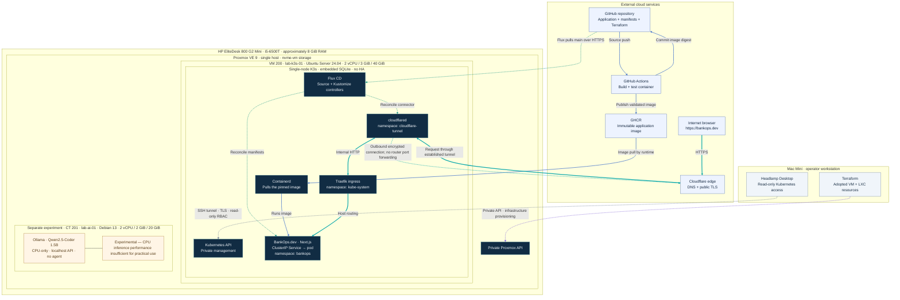

# Enterprise Platform Lab

A practical platform engineering lab built on a single Proxmox host. The project establishes a verified Ubuntu foundation, then progresses toward infrastructure as code, Kubernetes, GitOps, and observable application delivery.

## Objectives

- Maintain reproducible infrastructure configuration and operational documentation.
- Adopt the existing VM into Terraform without replacing infrastructure.
- Build a single-node K3s platform and progressively introduce GitOps, observability, and security controls.

## Current status

Baseline recorded on **2026-10-25**. Shared-host capacity, K3s health, the local LLM deployment, and a zero-change Terraform plan were verified on **2026-10-28**.

| Component | Status |
| --- | --- |
| Proxmox VE 9.2.21, node `pve` | Operational |
| Ubuntu `lab-k3s-01`, VMID 200 | Running; cloud-init completed |
| VM resources | 2 vCPU, 3072 MiB RAM, 40 GiB disk on `nvme-vm` |
| Guest OS | Ubuntu 24.04.5 LTS |
| Guest network | DHCP, observed `192.168.10.226/24` |
| SSH | Public-key login verified; password authentication disabled |
| Terraform | VM 200 and CT 201 adopted; zero-change plan verified |
| K3s | v1.36.5+k3s1; node Ready; DNS, ingress, and reboot recovery verified |
| BankOps.dev | Public HTTPS verified; Cloudflare Tunnel and Flux healthy |
| Local LLM | CT 201 lab-ai-01; CPU-only Ollama 0.40.12 and qwen2.5-coder:1.5b; SSH-only API |
| Headlamp Desktop | Mac v0.46.0; read-only context and SSH API tunnel verified |
| GitOps | Flux 2.10.0 source/kustomize controllers Ready; BankOps digest reconciliation verified |
| Observability stack | Planned; heavyweight monitoring not installed |

All addresses shown are **private LAN addresses**, not publicly reachable service endpoints. Access requires the lab LAN or an independently configured trusted access path. The DHCP address can change.

## Architecture and stack



[High-resolution LinkedIn PNG](docs/diagrams/enterprise-platform-lab-linkedin.png) · [Editable SVG](docs/diagrams/enterprise-platform-lab.svg) · [Diagram sources and evidence](docs/diagrams/README.md)

The host uses an Intel Core i5-6500T, approximately 8 GiB RAM, a SATA system SSD, and a separate NVMe VM datastore. The current toolchain is Terraform 1.17.0 with bpg/proxmox 0.118.0, Proxmox CLI, OpenSSH, and Ubuntu cloud-init. K3s uses SQLite, containerd, Flannel, CoreDNS, Traefik, and ServiceLB. Flux now reconciles the BankOps application from Git.

## Quick start

These commands inspect the existing lab; they do not provision infrastructure.

```sh
git status --short
terraform -chdir=terraform/environments/lab fmt -check
terraform -chdir=terraform/environments/lab validate
terraform -chdir=terraform/environments/lab state list
ssh proxmox-lab 'qm status 200'
```

For a fresh checkout, install a supported Terraform version and run `terraform -chdir=terraform/environments/lab init -lockfile=readonly` before validation. Validation requires the operator public-key file referenced by `ssh_public_key_path`; override that variable with your own public-key path where necessary. Do not copy private keys into the repository.

After verifying the guest host key through a trusted channel:

```sh
ssh -o StrictHostKeyChecking=yes -o IdentitiesOnly=yes \
  -i ~/.ssh/id_ed25519_proxmox ubuntu@192.168.10.226
```

The key path and SSH alias are operator-local prerequisites, not files distributed with this repository. Follow the [management access instructions](docs/02-proxmox-setup.md) and [guest verification procedures](docs/04-ubuntu-vm.md).

**VM 200 was provisioned with Proxmox CLI and subsequently adopted by Terraform.** Local state now contains the node data source, VM 200, and AI CT 201 resources. The import changed no infrastructure, and a fresh plan reports no changes. See the [adoption results](docs/03-terraform.md). State remains local and must be backed up securely; a fresh checkout does not include it.

## Documentation

1. [Architecture and decisions](docs/01-architecture.md)
2. [Proxmox setup and access](docs/02-proxmox-setup.md)
3. [Terraform workflow and image management](docs/03-terraform.md)
4. [Ubuntu VM configuration and verification](docs/04-ubuntu-vm.md)
5. [Security posture and improvements](docs/05-security.md)
6. [Roadmap and acceptance criteria](docs/06-roadmap.md)
7. [DORA-focused change evidence MVP — proposed scope and data contract](docs/12-dora-change-evidence.md)
7. [K3s installation, validation, and operations](docs/07-k3s.md)
8. [Headlamp Desktop access](docs/08-headlamp.md)
9. [Local LLM deployment, benchmarks, and SSH access](docs/09-local-llm.md)
10. [BankOps.dev website and GitOps delivery](docs/10-bankops-web.md)
11. [Cloudflare Tunnel, routing prerequisite, and recovery](docs/11-cloudflare-tunnel.md)

## Operational boundaries

Never run `terraform destroy`, delete existing infrastructure, or change Proxmox host networking, storage configuration, or authentication without explicit authorization. Additional VMs and destructive operations require explicit approval. Keep state, plans, credentials, and private keys outside Git. Preserve the repository's observed visibility; changing visibility requires explicit authorization. GitHub reports this repository as public as of 2026-10-28; never publish credentials or private runtime data.

## Adoption completed — 2026-10-25

The reviewed import-only plan adopted VM 200 with zero additions, changes, or deletions. A follow-up plan returned no changes. The VM remained running and reachable with no pending configuration changes. K3s was subsequently installed and validated; see the K3s milestone below.

## K3s installed — 2026-10-25

The existing VM now runs pinned K3s `v1.36.5+k3s1` with embedded SQLite and the default lightweight packaged components. Node Ready, API health, internal/external DNS, service traffic, Traefik ingress, and recovery after a guest reboot were verified. The guest firewall blocks direct LAN access to control-plane ports; use kubectl as ubuntu over SSH. No Proxmox host changes or VM recreation occurred. Terraform still reports no changes. See [operations and limitations](docs/07-k3s.md); secret material remains outside Git.

## Local LLM — 2026-10-28

lab-ai-01 is an isolated unprivileged Debian 13 LXC with 2 vCPU, 2 GiB RAM, zero swap, and a 20 GiB disk on nvme-vm. Ollama serves qwen2.5-coder:1.5b only on localhost, accessed from the Mac over an SSH tunnel. The guarded CPU benchmark measured about 12.7 generated tokens/s and 5.0 s warm response latency; host available RAM remained above 2.2 GiB during that benchmark, with no swap, OOM, or measured PSI average. Existing K3s workloads remained healthy. No agent or model execution access was installed. See [measured results and limitations](docs/09-local-llm.md).

## BankOps.dev — 2026-10-28

The first BankOps.dev product-introduction site is live at **http://lab-k3s-01.lan** on the private LAN. A tested, non-root Next.js container is published to GHCR and deployed by Flux from Git, using a dedicated bankops namespace and scoped application reconciliation. A modest navy/blue/teal visual refresh improves hero typography, conceptual evidence visuals, cards, navigation, and mobile spacing; visitor-facing GitHub links have been removed. The page clearly marks evidence automation as a proposed product direction; no business backend or database is implemented. A synthetic, read-only [change evidence demo](https://bankops.dev/demo) illustrates the first DORA-focused workflow without real records, approvals or a compliance verdict. See [build, deployment, and validation](docs/10-bankops-web.md).

## Cloudflare Tunnel — 2026-10-28

BankOps.dev is publicly available at **https://bankops.dev** through the Flux-managed bankops-production Cloudflare Tunnel. Normal-DNS HTTPS, actual HTML/assets, and WWW redirects preserving encoded paths/query strings are verified; desktop/mobile browser checks pass. K3s, Traefik, BankOps, and Flux remain healthy, with private LAN access preserved and no new management routes. Remaining follow-ups: enforce apex HTTP-to-HTTPS in Cloudflare and clear stale Mac system DNS state (Mac browser validation used observed edge addresses with TLS verification; VM normal DNS passed). See [verified launch results, security, and recovery](docs/11-cloudflare-tunnel.md).
