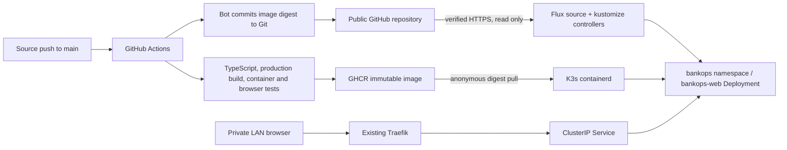

# BankOps.dev: website and GitOps delivery

[Project overview](../README.md) · [K3s operations](07-k3s.md)

## Delivered scope — 2026-10-28 Europe/Malta

Local website: **http://lab-k3s-01.lan**. The lab router currently resolves that name to 192.168.10.226. This is a private LAN application; no public DNS, port forwarding, tunnel-to-internet, or public ingress was configured. Kubernetes API, Proxmox, and Ollama exposure were not changed.

BankOps.dev is positioned as Compliance Evidence Automation for Financial Infrastructure. This first version is a responsive product-introduction page, with hero, proposed capabilities, intended workflow, audience sections for Platform Engineering/Infrastructure/Security/Compliance, contact CTA, and a compact product footer. The evidence visual is labeled illustrative; capabilities are labeled planned. No customers, testimonials, certifications, completed integrations, or working evidence-automation features are claimed.

The contact CTA moves to an on-page demo availability notice. No verified business contact address has been supplied, so requests are marked opening soon; the site does not claim a working demo or submit a form/store data. All user-facing GitHub references and destinations have been removed. Visitors are explicitly asked not to include confidential or regulated data. There is no business backend, database, account system, evidence collection, or live integration. /healthz is only an operational health handler.

## Architecture



The app is under [apps/bankops-web](../apps/bankops-web/): Next.js 16.4.3, React 19.3.1, TypeScript 7.0.2, and Node.js 24. The root page is prerendered. No external font service, analytics, or application-side outbound integration is required. Metadata uses noindex/nofollow for the private preview. Basic content-type, framing, referrer, and browser-permission headers are configured; no compliance/security certification is implied.

The multi-stage Dockerfile uses dependencies, builder, and runtime stages. Its Node 24 Alpine base is pinned by digest. Only Next standalone output (about 40 MiB before image packaging), static assets, and public files enter the runtime stage. The published image has 74560839 compressed layer bytes (about 71.1 MiB). The runner uses UID/GID 1001, a Docker healthcheck on /healthz, and NODE_ENV=production. Kubernetes also supplies startup, readiness, and liveness HTTP probes.

## Repository layout

```text
apps/bankops-web/                 Next.js source, lockfile, Dockerfile, browser checks
.github/workflows/bankops-web.yml Build, validate, publish, update Git digest
clusters/lab/flux-system/         Pinned Flux components and Git source/root sync
clusters/lab/bankops-access.yaml  Namespace and scoped application reconciler RBAC
clusters/lab/bankops-sync.yaml    Flux app reconciliation and health assessment
deploy/bankops/                   Deployment, Service, Traefik Ingress, NetworkPolicy
```

## Build and deployment process

Use Node.js 24, as in CI and the container. On this Mac it is installed separately at /opt/homebrew/opt/node@24/bin, preserving the existing default Node installation.

```sh
cd apps/bankops-web
export PATH="/opt/homebrew/opt/node@24/bin:$PATH"
npm ci --ignore-scripts
npm run typecheck
npm run build
npm start
# Separate terminal, after the production server starts:
npx playwright install chromium
npm run test:browser
```

With Docker available, build from apps/bankops-web and run the image on loopback. No Docker daemon or build service was added to the 3 GiB K3s VM; the amd64 production container was built and tested on a GitHub-hosted runner.

The [workflow](../.github/workflows/bankops-web.yml) runs for pushes to main and pull requests affecting application source or that workflow, and supports manual dispatch. Action references are pinned to commit SHAs. It installs locked dependencies, typechecks, builds the production image, and starts it read-only with all capabilities dropped, no privilege escalation, a 256 MiB memory limit, and writable temporary/cache mounts. It verifies UID/GID 1001, HTTP readiness, desktop/mobile browser behavior, and the image's Docker health state. Publishing happens only after these checks pass.

For main pushes, GitHub's temporary GITHUB_TOKEN is granted packages:write and contents:write. It authenticates to GHCR, publishes a commit-tagged image, resolves its digest, and commits that immutable reference to deploy/bankops/deployment.yaml. Checkout credential persistence is disabled; the commit step uses the temporary token in the job environment. No user PAT, cluster credential, or SSH private key is embedded in the image, repository, or workflow. Pull-request runs do not publish or update deployment Git.

The digest commit is made against a fresh origin/main checkout to preserve unrelated changes made during the build. Workflow concurrency serializes delivery for main. Application-path filtering avoids rebuild loops from the bot's manifest-only commit. Docs-only commits do not rebuild the image; Flux still sees new repository revisions. If a push races another writer, the workflow fails rather than force-pushing; rerun/review instead of overwriting history.

## Image registry

Image repository: **ghcr.io/atasenkeremdev/bankops-web**.

Validated deployment reference:

```text
ghcr.io/atasenkeremdev/bankops-web@sha256:07efb817976f9fd62b44d1da5f2c399f8b06e4f45f9ea4112ce4dd7079c8f8b6
```

The tag sha-896bfabbd0ba792e8b9665cd19049a1cb739afe3 records the application source revision; the Deployment uses the digest, not a moving latest tag. The running pod's imageID matched that same digest. Anonymous registry-manifest access returned HTTP 200, and K3s pulled the image without an imagePullSecret. Source and image are publicly readable; this does not expose the running application to the internet. No repository visibility setting was changed in this work.

GitHub reported the repository as PUBLIC during preflight, superseding earlier private-publication documentation. Existing gh CLI authorization could manage this repository/workflows but lacked the separate read:packages metadata scope; no extra PAT scope or persistent registry credential was needed because anonymous image pulls were verified. If package visibility is made private in the future, provide a dedicated read-only package credential through a reviewed secret-management path and validate rotation. Never commit a docker-registry Secret manifest containing credentials.

## Flux configuration and trust

Flux CLI 2.10.0 generated the pinned component manifests. Only source-controller v1.10.1 and kustomize-controller v1.10.1 are installed. No Helm, notification, image-reflector, or image-automation controllers were added. The two controllers each request 50m CPU/64 MiB RAM and are limited to 500m CPU/256 MiB RAM. The exported components are stored in Git and the root Flux Kustomization reconciles their configuration.

GitRepository flux-system reads main from the public repository over verified HTTPS every minute. Its artifact includes only clusters/ and deploy/ to keep reconciliation small. There is no permanent Git credential or write-capable deploy key in the cluster. The root Kustomization at ./clusters/lab uses prune:false so removing a root manifest does not automatically delete cluster controllers/namespaces.

The bankops-web Kustomization reconciles ./deploy/bankops every minute, retries after 30 seconds, and assesses Deployment availability. It impersonates bankops-reconciler in flux-system. That service account has a RoleBinding only in bankops for the required application resources; it cannot read Secrets or patch deployments in kube-system. Application pruning is enabled within this scoped resource set. The bootstrap/root Flux controllers retain standard cluster-level installation privileges; protect repository write access accordingly.

Bootstrap was performed through existing guest-admin SSH. Only non-secret rendered YAML was copied to the guest; no administrator kubeconfig was downloaded to the Mac. First the controller bundle was applied, then the Git source/root Kustomization. After that, Git delivered the app namespace, scoped RBAC, and application resources. Future changes should go through Git; manual edits may be reconciled away.

For investigation using existing administrative access:

```sh
ssh -o StrictHostKeyChecking=yes ubuntu@lab-k3s-01.lan
kubectl -n flux-system get gitrepositories,kustomizations
kubectl -n bankops get deployment,service,ingress,pods
kubectl -n bankops describe deployment bankops-web
kubectl -n flux-system logs deployment/kustomize-controller --tail=50
```

Use the existing operator SSH key and pinned host trust, as documented in the lab's guest guide. Do not bypass host-key checking. The Mac's Headlamp context remains read-only; cluster writes continue through the existing trusted guest-admin path. Flux CLI writes also require an authorized context; do not grant the dashboard identity cluster-admin for convenience.

## Kubernetes resources and capacity

One bankops-web replica runs in the dedicated bankops namespace, with restricted Pod Security admission. It requests 100m CPU/96 MiB RAM and is limited to 500m CPU/256 MiB RAM. Its Node old-space heap is capped at 160 MiB. It runs as UID/GID 1001 with fsGroup 1001, RuntimeDefault seccomp, all capabilities dropped, no privilege escalation, and a read-only root filesystem. Only /tmp and .next/cache have small 16 MiB emptyDir mounts. Service-account token mounting is disabled; there is no PVC or database.

RollingUpdate permits one surge pod and no unavailable replicas. Service bankops-web is ClusterIP on port 80 to container port 3000. Traefik serves host lab-k3s-01.lan on private HTTP port 80. The NetworkPolicy allows only Traefik pods in kube-system to reach port 3000 and denies application egress. Same-node kubelet probes remain permitted by Kubernetes networking behavior; image pulls happen through containerd, outside application pod egress.

Preflight showed 1972 MiB available in the 2972 MiB usable guest. The final sample showed 1791 MiB guest available and 1532 MiB Kubernetes node usage. Observed pods used about 38 MiB for bankops-web, 62 MiB for kustomize-controller, and 28 MiB for source-controller. The Proxmox host retained about 2859 MiB available RAM with zero swap and 0.00 memory PSI averages. These are point-in-time measurements, not capacity guarantees. No Proxmox VM/LXC hardware, disk, power, or networking configuration was changed, and no heavyweight build/monitoring service was installed in the lab.

## Validation evidence

| Check | Result |
| --- | --- |
| Local source | TypeScript and optimized Next build passed |
| Production dependencies | npm audit --omit=dev reported zero vulnerabilities at validation time |
| Local browsers | Desktop 1440px and mobile 390px: CTA, health, no overflow, no page errors passed |
| Workflow | actionlint passed; CI completed successfully |
| Container | Real amd64 Docker image built; non-root, read-only 256 MiB smoke run passed; Docker health healthy |
| CI browsers | Both desktop/mobile checks passed against the running container |
| Publishing | GHCR push succeeded only after tests; anonymous manifest pull HTTP 200 |
| GitOps trigger | Source commit 896bfab started CI; bot commit 904cb2f updated the digest; Flux applied it without a manual app apply |
| Deployment | bankops-web Available, one Running/Ready pod, zero restarts |
| Service | HTTP 200 /healthz through ClusterIP from the actual Traefik pod |
| LAN ingress | HTTP 200 at http://lab-k3s-01.lan/healthz and full landing page |
| Live browsers | Both desktop/mobile checks passed against the deployed private URL |
| Runtime boundary | UID/GID 1001 confirmed; attempted /app write denied with EROFS |
| App reconciler | Deployment patch in bankops allowed; Secret read and kube-system deployment patch denied |
| Flux | GitRepository, root Kustomization, and bankops-web Kustomization Ready |
| Existing lab | K3s Ready, existing workloads healthy; Proxmox guests remained running |

CI run: [40604389702](https://github.com/atasenkeremdev/enterprise-platform-lab/actions/runs/40604389702). Source: [896bfab](https://github.com/atasenkeremdev/enterprise-platform-lab/commit/896bfabbd0ba792e8b9665cd19049a1cb739afe3). Automated deployment update: [904cb2f](https://github.com/atasenkeremdev/enterprise-platform-lab/commit/904cb2fb38edb3e7887158d1468eff35d1691da6).

During first bootstrap, the app briefly waited for the not-yet-published bootstrap tag and recorded ImagePullBackOff events. CI's digest commit replaced that placeholder, and the old pod was removed by normal rollout. One initial startup probe was refused while Next started; it recovered with zero container restarts. Historical events are not ongoing failures. No destructive changes were required.

## Updating, rollback, and troubleshooting

Change app source, open a PR, review the build/browser checks, and merge to main. The workflow publishes an immutable image and commits its digest; Flux normally applies it within its one-minute polling cycle. Observe Deployment availability and the Flux conditions before declaring release success. For a bad release, revert the relevant source/digest change in Git and let Flux reconcile a previously validated digest. Do not force-push or use permanent manual kubectl image changes as the deployment method.

If the site is unreachable, confirm the Mac is on the lab network and lab-k3s-01.lan resolves to the current DHCP address. `curl --resolve lab-k3s-01.lan:80:192.168.10.226 http://lab-k3s-01.lan/healthz` can separate DNS from routing. Check the Ingress host/class and Service selector before changing Traefik. An IP-only request without the host may receive Traefik's default 404.

For image failures, compare Git's digest with pod events, verify anonymous registry access, and inspect workflow publishing. For Flux failures, check source revision, path, scoped RBAC, and Deployment health conditions. Do not weaken the network policy or grant cluster-admin to the app to bypass a configuration problem. Resource pressure should lead to capacity review, not Proxmox overcommit or installing build tools on the 3 GiB VM.

## Remaining work before public launch

- Verify BankOps.dev domain ownership and design the intended public DNS/ingress boundary; no domain ownership is assumed here.
- Configure trusted HTTPS certificates and renewal, choose an appropriate TLS/ACME validation method, and review firewall/router exposure before opening anything publicly.
- Decide the real private business contact/demo workflow, privacy notice, and terms; the current CTA leads to an availability notice until a verified contact channel is provided. Do not collect sensitive evidence through a public contact flow.
- Design backend, tenant identity, authorization, data residency/retention, evidence provenance, and secret handling separately. None are implemented by this landing page.
- Add appropriate branch protections/review rules, image vulnerability scanning/provenance, and operational alerting/rollback drills before relying on this for production delivery.

No public route to Kubernetes API, Proxmox, or Ollama is part of any public website rollout. Keep those management/model endpoints separately protected.

## Cloudflare Tunnel follow-up — 2026-10-28

A separate Flux-managed cloudflared connector is now deployed and Ready. The public apex/WWW Ingress rules and WWW canonical redirect are validated at the origin, with LAN access preserved. Public HTTPS now returns the expected application, with seven referenced assets verified and desktop/mobile checks passing. Normal-DNS WWW redirects preserve paths/query strings. Both remote origins correctly use HTTP port 80. Apex HTTP-to-HTTPS enforcement and Mac resolver cleanup remain documented follow-ups. See [Cloudflare launch validation and operations](11-cloudflare-tunnel.md). The application image/build pipeline is unchanged.

## Modest visual refresh — 2026-10-28

The existing section structure is preserved. The hero now uses “Infrastructure changes. Clearer evidence.” with a concise financial-infrastructure value proposition and a prominent Request a demo anchor. A navy/blue/teal palette, subtle gradient surfaces, clearer card boundaries, restrained hover elevation, and refined navigation/footer improve hierarchy without a new UI library, font download, or dependency. The evidence workflow remains explicitly conceptual with no live collection. All visitor-facing GitHub text, icons, and links are removed; the repository-based build and GitOps architecture remains unchanged.

Local validation: TypeScript and optimized production build passed. Four Playwright checks passed across desktop/mobile, including a 320-pixel layout, keyboard skip link, reduced motion, contact anchor, expected content, no GitHub destination/text, health response, and no page JavaScript errors or failed static asset responses. Desktop/mobile screenshots were reviewed. The entry animation is disabled with prefers-reduced-motion; visible keyboard focus styles and semantic sections remain.

Deployment uses the existing Actions → GHCR → immutable image digest commit → Flux pipeline. Final pipeline and public validation results are recorded below. No Proxmox or cluster configuration change is required.

### Verified refresh deployment

- Source commit: cab4799d3989e0e62ae6e4082feb6391e89b31ef. [CI run 40612622067](https://github.com/atasenkeremdev/enterprise-platform-lab/actions/runs/40612622067) passed production image build, constrained non-root/read-only container startup, all four browser checks, healthcheck, publication, and digest commit.
- Automated deployment commit: 3441e109c3daf45ce0d62a692576ae6672a9e556. Published/deployed image: ghcr.io/atasenkeremdev/bankops-web@sha256:428bfe1cc3125aa22cd49a02d13dc41a38c46106dd508d5df420c5dd012c2505. No manual cluster configuration edit was made.
- Flux source and all three Kustomizations reconciled that deployment revision and were Ready. BankOps rolled out successfully, with its new pod 1/1 Ready and zero restarts. Node, Traefik, tunnel and existing running workloads remained healthy.
- https://bankops.dev returned HTTP 200 with successful certificate validation using normal DNS from the VM. HTML contained the new headline and conceptual-preview label and no GitHub references; /healthz returned status ok.
- Public desktop/mobile Chromium checks passed for new content, six browser-requested static assets, CTA anchor, conceptual disclosure, no visible GitHub text/destinations, no horizontal overflow, and no JavaScript errors. Mac system DNS still failed, so these browser checks explicitly mapped the previously DNS-observed Cloudflare edge addresses while preserving HTTPS hostname/SNI and certificate validation; VM normal-DNS verification is separate.
- Remaining product follow-up: supply a verified business contact address to replace the honest “Demo requests opening soon” notice. Existing Mac DNS and apex HTTP-to-HTTPS operational follow-ups remain in the Cloudflare guide. No backend, new dependency, Proxmox change, or cluster configuration change was introduced.

## DORA-focused synthetic demo — 2026-10-28

/demo adds a read-only product walkthrough to the existing application. Header, hero secondary CTA, contact panel and footer expose the walkthrough without adding visitor-facing GitHub links. The original Request a demo anchor still reaches the contact section; personal demo requests remain unavailable until a business contact channel is configured.

The demo displays the proposed draft change package, fictional owners, risk/fallback context, source/collection timestamps, missing evidence, independent review status, and implementation gaps. Native details disclosures and accessible pressed-state filter buttons work with keyboard input. /demo/change-evidence.synthetic.json is a static synthetic download, not an API, uploaded record or compliance report. There is no backend/database, dependency addition, live collection, approval action or cluster configuration change. The UI expressly disclaims a DORA compliance assessment; regulatory anchors link to the official published texts.

Local TypeScript and optimized production build passed. Eight desktop/mobile browser tests passed, including fixture parity, gap filtering, disclosures, no data-writing requests or source fetching, no inputs/uploads/approval controls, no GitHub references, 320-pixel layout, keyboard access and reduced motion. Desktop/mobile screenshots were reviewed. Existing Actions/GHCR/Flux delivery remains the deployment path; final public rollout results follow after validation.

### Verified demo publication

- Source: b31f6b6cba79804f77ee0724bc16292192556fa8; [CI run 40764904586](https://github.com/atasenkeremdev/enterprise-platform-lab/actions/runs/40764904586) succeeded, including all browser checks and constrained production container health.
- Automated digest commit: a3b9d27e8074f2ec57b736a7cbd384c8ff1ee1c3. Image: ghcr.io/atasenkeremdev/bankops-web@sha256:07a7ecc76832843adbb14862c25acd134e291c9f21605f1ce8722e74e90a2818.
- Public https://bankops.dev/demo returned 200 with TLS verification result 0 using normal Mac DNS. All eight existing/new Playwright checks passed against the public HTTPS site, including desktop/mobile/320-pixel layout and the served fixture’s equality with the canonical example. No DNS mapping or certificate bypass was used.
- https://www.bankops.dev/demo?source=validation completed at https://bankops.dev/demo?source=validation in one redirect with 200. /healthz returned status ok.
- The new BankOps pod was 1/1 Ready with zero restarts; Flux source and all three Kustomizations reconciled the digest commit and were Ready. Existing workloads remained healthy. Guest available RAM was 1638 MiB after rollout; no RAM or cluster configuration increase was required.
- The earlier Mac DNS failure was not reproduced during these checks. This does not change the separately documented apex HTTP-to-HTTPS follow-up.

## Development / Infra scenario expansion

/demo now offers four synthetic scenarios: Development-owned application image changes and Infra-owned AKS platform/node pool, on-prem OpenShift platform and RHEL OS changes. The ownership panel separates primary responsibility, supporting teams, excluded scope and independent review. Each evidence disclosure names its contributor. The selected package controls its own download and source provenance; no live integration, real approval, writes or new backend is added. See [scenario model and source references](12-dora-change-evidence.md#responsibility-aware-scenarios).

Production build and TypeScript passed. Fourteen local desktop/mobile browser checks passed; all four public fixture copies match the canonical records and validate against the existing schema. Screenshots were reviewed and 320-pixel layout checked. The existing Actions → GHCR → Flux path publishes the update without cluster or Proxmox configuration changes. Final public rollout verification is recorded below after deployment.

### Verified responsibility scenario publication

- Source commit: 151ee7aedd5699ac86fd916433a9ba79edfd61a7. [CI run 40767287533](https://github.com/atasenkeremdev/enterprise-platform-lab/actions/runs/40767287533) passed production build, constrained container health, fourteen browser checks, GHCR publication and the automated digest update.
- Deployment commit: fe4a5748b869de5d13a61d0e1f233970ffdd4ab7. Image: ghcr.io/atasenkeremdev/bankops-web@sha256:c462a11c5eb9fcdaebdbaa4a36e255b0693e65a9f1fc7342d4bedb52d477f4e6.
- After rollout completed, fourteen public HTTPS browser checks passed using normal DNS, including all four scenario downloads, Development/Infra ownership, provider boundaries, filter/detail reset, keyboard entry and responsive layout. /demo returned 200 with TLS verification result 0; WWW preserved /demo?scenario=validation and reached apex 200 in one redirect.
- An earlier public test run near rollout completion received Cloudflare 502 on two landing-page requests; twelve checks passed and two timed out on the error page. Subsequent root requests returned 200 and the complete post-rollout suite passed. This transient is recorded rather than treated as a clean initial run; exact root cause was not established and zero-downtime delivery is not claimed. No routing/firewall/cluster changes were made to mask it.
- BankOps new pod was 1/1 Ready, zero restarts; node and other running workloads were healthy. Flux source and all three Kustomizations reconciled the deployment commit and were Ready. Guest available RAM was 1680 MiB with no swap. No Proxmox configuration, RAM allocation, live AKS/OpenShift/RHEL system or new backend was changed.

## Demo clarity improvements

/demo adds an inline reading guide, plain-language field questions, suggested DORA/RTS references, concrete scenario-specific evidence examples, a status glossary and source/collection-time explanations. The screen separates requested evidence from what the fictional package actually contains. A missing item is not presented as a DORA breach, and downloads are explicitly draft data rather than compliance reports. No contract, source fixture, dependency, backend or cluster configuration change was required.

Local production build and TypeScript passed, as did fourteen desktop/mobile checks. Tests cover explanation visibility, official reference destinations, contributor selection, preserved scenario/download behaviour, keyboard access and existing safety constraints. Desktop/mobile screenshots with an expanded OpenShift check were reviewed; 320-pixel width showed no overflow. Publication results follow after the existing pipeline completes.

### Verified clarity update publication

Source: 8d98f44c9a21f803c9ec33bbaabaa5d869a912d7. [CI run 40769626705](https://github.com/atasenkeremdev/enterprise-platform-lab/actions/runs/40769626705) passed all build, constrained container, browser and publication checks. Automated deployment commit: 05697990004e7f99d3b14f4e856bfc105d031c9a. Image: ghcr.io/atasenkeremdev/bankops-web@sha256:4a970f70cf1fa7b829a63f2a857ebb4dda748b321d64290a06aeedcb621b790b.

After rollout completion, all fourteen public HTTPS desktop/mobile tests passed via normal DNS, including reading-guide/status explanations, suggested official reference links, ownership/scenario changes, fixture downloads and existing no-write constraints. /demo returned 200 with TLS verification result 0. The BankOps pod was 1/1 Ready with zero restarts; K3s, Traefik and cloudflared were healthy. Flux source and all three Kustomizations were Ready on the deployment commit. No infrastructure or cluster configuration was modified.

## Concrete OpenShift technical output walkthrough

The OpenShift selection adds a requested 4.18→4.22 plan, baseline-versus-missing-after comparison, selectable ClusterVersion/Operator/MachineConfigPool/Node JSON excerpts, interpretation, artifact provenance, a related evidence-row link and a static technical download. All output is hand-authored synthetic data. The exact target patch, recommended path, approval, implementation and after-change observations are not invented. No direct-upgrade command, command execution button or collector was added. Only the OpenShift scenario has this technical panel.

Sixteen local desktop/mobile checks passed, including keyboard output selection, exact raw-output/download parity, missing outcome/path assertions, evidence navigation, 320-pixel layout and preservation of all existing scenarios. Screenshots were reviewed. The updated draft package validates against the existing contract; its public copy and the separate technical fixture match their canonical files. No backend, dependency or infrastructure/cluster configuration change was needed. Deployment evidence follows after publication.

The first public technical-panel test run passed 15/16 checks but exposed one early mobile click before React hydration: the gaps filter was visible but its handler was not yet attached. Controls now render disabled on the server and enable after hydration, preventing ignored initial interactions. A server-HTML regression check was added. The subsequent local production suite passed all eighteen checks; no infrastructure change or test retry setting was used to hide the issue.
