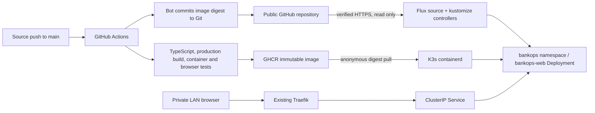

# BankOps.dev: website and GitOps delivery

[Project overview](../README.md) · [K3s operations](07-k3s.md)

## Delivered scope — 2026-10-28 Europe/Malta

Local website: **http://lab-k3s-01.lan**. The lab router currently resolves that name to 192.168.10.226. This is a private LAN application; no public DNS, port forwarding, tunnel-to-internet, or public ingress was configured. Kubernetes API, Proxmox, and Ollama exposure were not changed.

BankOps.dev is positioned as Compliance Evidence Automation for Financial Infrastructure. This first version is a responsive product-introduction page, with hero, proposed capabilities, intended workflow, audience sections for Platform Engineering/Infrastructure/Security/Compliance, contact CTA, and GitHub footer. The evidence visual is labeled illustrative; capabilities are labeled planned. No customers, testimonials, certifications, completed integrations, or working evidence-automation features are claimed.

The contact CTA opens a new issue in the existing GitHub repository. It does not submit a form or store data. Visitors are explicitly asked not to include confidential or regulated data. There is no business backend, database, account system, evidence collection, or live integration. /healthz is only an operational health handler.

## Architecture



The app is under [apps/bankops-web](../apps/bankops-web/): Next.js 16.4.3, React 19.3.1, TypeScript 7.0.2, and Node.js 24. The root page is prerendered. No external font service, analytics, or application-side outbound integration is required. Metadata uses noindex/nofollow for the private preview. Basic content-type, framing, referrer, and browser-permission headers are configured; no compliance/security certification is implied.

The multi-stage Dockerfile uses dependencies, builder, and runtime stages. Its Node 24 Alpine base is pinned by digest. Only Next standalone output (about 40 MiB before image packaging), static assets, and public files enter the runtime stage. The published image has 74560839 compressed layer bytes (about 71.1 MiB). The runner uses UID/GID 1001, a Docker healthcheck on /healthz, and NODE_ENV=production. Kubernetes also supplies startup, readiness, and liveness HTTP probes.

## Repository layout

```text
apps/bankops-web/                 Next.js source, lockfile, Dockerfile, browser checks
.github/workflows/bankops-web.yml Build, validate, publish, update Git digest
clusters/lab/flux-system/         Pinned Flux components and Git source/root sync
clusters/lab/bankops-access.yaml  Namespace and scoped application reconciler RBAC
clusters/lab/bankops-sync.yaml    Flux app reconciliation and health assessment
deploy/bankops/                   Deployment, Service, Traefik Ingress, NetworkPolicy
```

## Build and deployment process

Use Node.js 24, as in CI and the container. On this Mac it is installed separately at /opt/homebrew/opt/node@24/bin, preserving the existing default Node installation.

```sh
cd apps/bankops-web
export PATH="/opt/homebrew/opt/node@24/bin:$PATH"
npm ci --ignore-scripts
npm run typecheck
npm run build
npm start
# Separate terminal, after the production server starts:
npx playwright install chromium
npm run test:browser
```

With Docker available, build from apps/bankops-web and run the image on loopback. No Docker daemon or build service was added to the 3 GiB K3s VM; the amd64 production container was built and tested on a GitHub-hosted runner.

The [workflow](../.github/workflows/bankops-web.yml) runs for pushes to main and pull requests affecting application source or that workflow, and supports manual dispatch. Action references are pinned to commit SHAs. It installs locked dependencies, typechecks, builds the production image, and starts it read-only with all capabilities dropped, no privilege escalation, a 256 MiB memory limit, and writable temporary/cache mounts. It verifies UID/GID 1001, HTTP readiness, desktop/mobile browser behavior, and the image's Docker health state. Publishing happens only after these checks pass.

For main pushes, GitHub's temporary GITHUB_TOKEN is granted packages:write and contents:write. It authenticates to GHCR, publishes a commit-tagged image, resolves its digest, and commits that immutable reference to deploy/bankops/deployment.yaml. Checkout credential persistence is disabled; the commit step uses the temporary token in the job environment. No user PAT, cluster credential, or SSH private key is embedded in the image, repository, or workflow. Pull-request runs do not publish or update deployment Git.

The digest commit is made against a fresh origin/main checkout to preserve unrelated changes made during the build. Workflow concurrency serializes delivery for main. Application-path filtering avoids rebuild loops from the bot's manifest-only commit. Docs-only commits do not rebuild the image; Flux still sees new repository revisions. If a push races another writer, the workflow fails rather than force-pushing; rerun/review instead of overwriting history.

## Image registry

Image repository: **ghcr.io/atasenkeremdev/bankops-web**.

Validated deployment reference:

```text
ghcr.io/atasenkeremdev/bankops-web@sha256:07efb817976f9fd62b44d1da5f2c399f8b06e4f45f9ea4112ce4dd7079c8f8b6
```

The tag sha-896bfabbd0ba792e8b9665cd19049a1cb739afe3 records the application source revision; the Deployment uses the digest, not a moving latest tag. The running pod's imageID matched that same digest. Anonymous registry-manifest access returned HTTP 200, and K3s pulled the image without an imagePullSecret. Source and image are publicly readable; this does not expose the running application to the internet. No repository visibility setting was changed in this work.

GitHub reported the repository as PUBLIC during preflight, superseding earlier private-publication documentation. Existing gh CLI authorization could manage this repository/workflows but lacked the separate read:packages metadata scope; no extra PAT scope or persistent registry credential was needed because anonymous image pulls were verified. If package visibility is made private in the future, provide a dedicated read-only package credential through a reviewed secret-management path and validate rotation. Never commit a docker-registry Secret manifest containing credentials.

## Flux configuration and trust

Flux CLI 2.10.0 generated the pinned component manifests. Only source-controller v1.10.1 and kustomize-controller v1.10.1 are installed. No Helm, notification, image-reflector, or image-automation controllers were added. The two controllers each request 50m CPU/64 MiB RAM and are limited to 500m CPU/256 MiB RAM. The exported components are stored in Git and the root Flux Kustomization reconciles their configuration.

GitRepository flux-system reads main from the public repository over verified HTTPS every minute. Its artifact includes only clusters/ and deploy/ to keep reconciliation small. There is no permanent Git credential or write-capable deploy key in the cluster. The root Kustomization at ./clusters/lab uses prune:false so removing a root manifest does not automatically delete cluster controllers/namespaces.

The bankops-web Kustomization reconciles ./deploy/bankops every minute, retries after 30 seconds, and assesses Deployment availability. It impersonates bankops-reconciler in flux-system. That service account has a RoleBinding only in bankops for the required application resources; it cannot read Secrets or patch deployments in kube-system. Application pruning is enabled within this scoped resource set. The bootstrap/root Flux controllers retain standard cluster-level installation privileges; protect repository write access accordingly.

Bootstrap was performed through existing guest-admin SSH. Only non-secret rendered YAML was copied to the guest; no administrator kubeconfig was downloaded to the Mac. First the controller bundle was applied, then the Git source/root Kustomization. After that, Git delivered the app namespace, scoped RBAC, and application resources. Future changes should go through Git; manual edits may be reconciled away.

For investigation using existing administrative access:

```sh
ssh -o StrictHostKeyChecking=yes ubuntu@lab-k3s-01.lan
kubectl -n flux-system get gitrepositories,kustomizations
kubectl -n bankops get deployment,service,ingress,pods
kubectl -n bankops describe deployment bankops-web
kubectl -n flux-system logs deployment/kustomize-controller --tail=50
```

Use the existing operator SSH key and pinned host trust, as documented in the lab's guest guide. Do not bypass host-key checking. The Mac's Headlamp context remains read-only; cluster writes continue through the existing trusted guest-admin path. Flux CLI writes also require an authorized context; do not grant the dashboard identity cluster-admin for convenience.

## Kubernetes resources and capacity

One bankops-web replica runs in the dedicated bankops namespace, with restricted Pod Security admission. It requests 100m CPU/96 MiB RAM and is limited to 500m CPU/256 MiB RAM. Its Node old-space heap is capped at 160 MiB. It runs as UID/GID 1001 with fsGroup 1001, RuntimeDefault seccomp, all capabilities dropped, no privilege escalation, and a read-only root filesystem. Only /tmp and .next/cache have small 16 MiB emptyDir mounts. Service-account token mounting is disabled; there is no PVC or database.

RollingUpdate permits one surge pod and no unavailable replicas. Service bankops-web is ClusterIP on port 80 to container port 3000. Traefik serves host lab-k3s-01.lan on private HTTP port 80. The NetworkPolicy allows only Traefik pods in kube-system to reach port 3000 and denies application egress. Same-node kubelet probes remain permitted by Kubernetes networking behavior; image pulls happen through containerd, outside application pod egress.

Preflight showed 1972 MiB available in the 2972 MiB usable guest. The final sample showed 1791 MiB guest available and 1532 MiB Kubernetes node usage. Observed pods used about 38 MiB for bankops-web, 62 MiB for kustomize-controller, and 28 MiB for source-controller. The Proxmox host retained about 2859 MiB available RAM with zero swap and 0.00 memory PSI averages. These are point-in-time measurements, not capacity guarantees. No Proxmox VM/LXC hardware, disk, power, or networking configuration was changed, and no heavyweight build/monitoring service was installed in the lab.

## Validation evidence

| Check | Result |
| --- | --- |
| Local source | TypeScript and optimized Next build passed |
| Production dependencies | npm audit --omit=dev reported zero vulnerabilities at validation time |
| Local browsers | Desktop 1440px and mobile 390px: CTA, health, no overflow, no page errors passed |
| Workflow | actionlint passed; CI completed successfully |
| Container | Real amd64 Docker image built; non-root, read-only 256 MiB smoke run passed; Docker health healthy |
| CI browsers | Both desktop/mobile checks passed against the running container |
| Publishing | GHCR push succeeded only after tests; anonymous manifest pull HTTP 200 |
| GitOps trigger | Source commit 896bfab started CI; bot commit 904cb2f updated the digest; Flux applied it without a manual app apply |
| Deployment | bankops-web Available, one Running/Ready pod, zero restarts |
| Service | HTTP 200 /healthz through ClusterIP from the actual Traefik pod |
| LAN ingress | HTTP 200 at http://lab-k3s-01.lan/healthz and full landing page |
| Live browsers | Both desktop/mobile checks passed against the deployed private URL |
| Runtime boundary | UID/GID 1001 confirmed; attempted /app write denied with EROFS |
| App reconciler | Deployment patch in bankops allowed; Secret read and kube-system deployment patch denied |
| Flux | GitRepository, root Kustomization, and bankops-web Kustomization Ready |
| Existing lab | K3s Ready, existing workloads healthy; Proxmox guests remained running |

CI run: [40604389702](https://github.com/atasenkeremdev/enterprise-platform-lab/actions/runs/40604389702). Source: [896bfab](https://github.com/atasenkeremdev/enterprise-platform-lab/commit/896bfabbd0ba792e8b9665cd19049a1cb739afe3). Automated deployment update: [904cb2f](https://github.com/atasenkeremdev/enterprise-platform-lab/commit/904cb2fb38edb3e7887158d1468eff35d1691da6).

During first bootstrap, the app briefly waited for the not-yet-published bootstrap tag and recorded ImagePullBackOff events. CI's digest commit replaced that placeholder, and the old pod was removed by normal rollout. One initial startup probe was refused while Next started; it recovered with zero container restarts. Historical events are not ongoing failures. No destructive changes were required.

## Updating, rollback, and troubleshooting

Change app source, open a PR, review the build/browser checks, and merge to main. The workflow publishes an immutable image and commits its digest; Flux normally applies it within its one-minute polling cycle. Observe Deployment availability and the Flux conditions before declaring release success. For a bad release, revert the relevant source/digest change in Git and let Flux reconcile a previously validated digest. Do not force-push or use permanent manual kubectl image changes as the deployment method.

If the site is unreachable, confirm the Mac is on the lab network and lab-k3s-01.lan resolves to the current DHCP address. `curl --resolve lab-k3s-01.lan:80:192.168.10.226 http://lab-k3s-01.lan/healthz` can separate DNS from routing. Check the Ingress host/class and Service selector before changing Traefik. An IP-only request without the host may receive Traefik's default 404.

For image failures, compare Git's digest with pod events, verify anonymous registry access, and inspect workflow publishing. For Flux failures, check source revision, path, scoped RBAC, and Deployment health conditions. Do not weaken the network policy or grant cluster-admin to the app to bypass a configuration problem. Resource pressure should lead to capacity review, not Proxmox overcommit or installing build tools on the 3 GiB VM.

## Remaining work before public launch

- Verify BankOps.dev domain ownership and design the intended public DNS/ingress boundary; no domain ownership is assumed here.
- Configure trusted HTTPS certificates and renewal, choose an appropriate TLS/ACME validation method, and review firewall/router exposure before opening anything publicly.
- Decide the real private business contact/demo workflow, privacy notice, and terms; the current CTA is a public GitHub issue and must not collect sensitive evidence.
- Design backend, tenant identity, authorization, data residency/retention, evidence provenance, and secret handling separately. None are implemented by this landing page.
- Add appropriate branch protections/review rules, image vulnerability scanning/provenance, and operational alerting/rollback drills before relying on this for production delivery.

No public route to Kubernetes API, Proxmox, or Ollama is part of any public website rollout. Keep those management/model endpoints separately protected.

## Cloudflare Tunnel follow-up — 2026-10-28

A separate Flux-managed cloudflared connector is now deployed and Ready. The public apex/WWW Ingress rules and WWW canonical redirect are validated at the origin, with LAN access preserved. The WWW route resolves but incorrectly targets the origin using HTTPS on port 80 (502); the apex route/DNS is still absent. Public application and mobile validation remain pending. See [Cloudflare operations and exact account actions](11-cloudflare-tunnel.md). The application image/build pipeline is unchanged.
