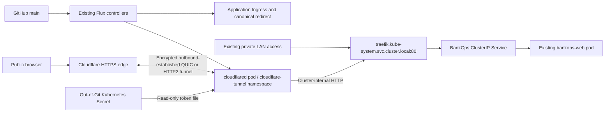

# BankOps.dev Cloudflare Tunnel

[Website operations](10-bankops-web.md) · [Project overview](../README.md)

## Current result — 2026-10-28

**Public HTTPS launch is verified at https://bankops.dev.** Normal-DNS requests from the VM return HTTP/2 200 with certificate verification enabled. Both published routes now correctly use HTTP to Traefik port 80. HTTPS WWW redirects, HTML, application assets, and desktop/mobile browser behavior pass. Remaining follow-ups: enforce apex HTTP-to-HTTPS at Cloudflare and clear the Mac’s stale system DNS state; neither blocks the independently verified public HTTPS endpoint.

| Item | Verified result |
| --- | --- |
| Intended public URL | https://bankops.dev — public HTTPS verified |
| Tunnel name | bankops-production, supplied by the operator |
| Tunnel identity | e7373f52-8229-4a27-a9ee-ee64b3794a8c, verified against token metadata and connector startup |
| Connector | cloudflare-tunnel/cloudflared, 1/1 Available, Ready, zero restarts |
| Cloudflare connections | Four registered QUIC connections; readiness endpoint HTTP 200 |
| Flux | GitRepository, root, bankops-web, and cloudflare-tunnel Kustomizations Ready |
| Token file | operator-local file verified as a regular file with mode 0600; contents never displayed |
| Kubernetes Secret | cloudflare-tunnel/cloudflared-token, created outside Git over encrypted SSH stdin |
| Private URL | http://lab-k3s-01.lan/healthz returns HTTP 200 |
| Apex origin routing | Host bankops.dev returns BankOps content through private Traefik |
| WWW origin routing | HTTP 301 to https://bankops.dev, preserving paths and query strings, including encoded values |
| Public DNS | Apex and WWW resolve to Cloudflare; router resolver and 1.1.1.1 return edge IPv4 addresses 104.21.96.74 and 172.67.174.70 |
| Edge certificate verification | Normal-DNS HTTPS from the VM passed for apex and WWW; no certificate bypass |
| Public application responses | Apex HTTP/2 200; BankOps HTML and /healthz confirmed; seven referenced JS/CSS assets return 200 with expected content types |
| Public mobile / end-to-end redirects | Desktop/mobile content, CTA, layout and JavaScript checks passed using observed edge addresses on Mac; WWW encoded path/query redirect passed via normal DNS on VM |
| Existing workloads | K3s Ready; BankOps, Flux, Traefik, and system workloads healthy |

Readiness and registered connections prove the supplied token can connect this connector to Cloudflare. Account-level tunnel status and configuration were not queried through Cloudflare's management API; only the connector token was provided. Its authority is not a substitute for account/DNS management access.

## Architecture



No router port forwarding, public node IP, LoadBalancer for cloudflared, host networking, host port, or new public management route is used. Cloudflared initiates connections outbound. Public TLS terminates at Cloudflare; the connector-to-edge transport is encrypted. The final connector-to-Traefik hop is HTTP on the cluster network. This is not a claim of TLS on every internal hop; assess that separately if future product data handling requires it.

The remotely managed tunnel's published application routes remain Cloudflare account configuration. Flux manages connector execution and Kubernetes routing; it cannot create Cloudflare DNS from the connector token. The existing Next.js app/image and GitHub Actions publishing architecture are unchanged.

## Verified Cloudflare routes and remaining HTTPS redirect

Under **Cloudflare dashboard → Networking → Tunnels → bankops-production → Routes**, preserve the following configuration. Both routes were verified in the connector’s received configuration after the operator corrected account settings:

| Hostname | Service type | Service URL |
| --- | --- | --- |
| bankops.dev | HTTP | traefik.kube-system.svc.cluster.local:80 |
| www.bankops.dev | HTTP | traefik.kube-system.svc.cluster.local:80 |

For the apex, leave the subdomain empty and select bankops.dev. For WWW, use subdomain www and domain bankops.dev. Leave path matching unset to include all application paths. Under HTTP origin settings, leave HTTP Host Header unset so the original public hostname reaches Traefik. Explicit respective public hostnames also work; do not override WWW to the apex or to the service DNS name, because that bypasses canonical routing or produces a Traefik 404.

Allow Cloudflare to create the associated proxied DNS records. If an existing record conflicts, inspect it before making changes. Do not point DNS at the lab's private address or configure router forwarding. Both public names now resolve; do not recreate working records unnecessarily. The expected tunnel target, derived from the supplied real tunnel ID, is `e7373f52-8229-4a27-a9ee-ee64b3794a8c.cfargotunnel.com`. Public DNS and successful tunnel-backed requests validate routing; account DNS records were not read through a management API. Proxied/flattened DNS normally returns edge addresses rather than exposing that CNAME in recursive queries.

Next, open **bankops.dev → SSL/TLS → Edge Certificates** and confirm an active certificate covers bankops.dev and www.bankops.dev. Do not bypass certificate validation to work around pending issuance.

For canonical HTTPS at the edge, create a scoped rule under **bankops.dev → Rules → Redirect Rules → Create rule → Custom filter expression**:

```text
(http.host eq "www.bankops.dev") or
(http.host eq "bankops.dev" and not ssl)
```

Choose a **Dynamic** URL redirect, status **301**, destination:

```text
concat("https://bankops.dev", http.request.uri.path)
```

Enable **Preserve query string**. The rule does not match HTTPS apex requests, avoiding a canonical redirect loop. **Remaining action:** the verified plain-HTTP apex /healthz request returned 200, so HTTPS enforcement is not active for that path. Apply or correct this scoped edge rule, then recheck HTTP requests redirect to HTTPS while retaining paths and query strings. Review existing rules for conflicts instead of adding duplicate/opposite redirects. The Git-managed Traefik WWW redirect is a fallback and is already validated; it intentionally does not force origin HTTP to HTTPS, which could loop because the tunnel's internal service URL is HTTP. The edge rule handles insecure apex requests.

Official references: [published application routes](https://developers.cloudflare.com/tunnel/get-started/), [tunnel token scope](https://developers.cloudflare.com/tunnel/reference/tunnel-tokens/), [redirect rules](https://developers.cloudflare.com/rules/url-forwarding/single-redirects/create-dashboard/), and [ssl request field](https://developers.cloudflare.com/ruleset-engine/rules-language/fields/reference/ssl/).

## Kubernetes and GitOps configuration

[deploy/cloudflare-tunnel](../deploy/cloudflare-tunnel/) contains the single-replica Deployment and network policy. It pins cloudflare/cloudflared 2026.10.5 to:

```text
sha256:1b1d34d0a9c0bfca9de72db8460d328db3f19edd2b96169114e3e893a97bbe53
```

The connector requests 25m CPU/32 MiB memory and is limited to 250m CPU/128 MiB. A final sample showed approximately 3m CPU/16 MiB memory. The K3s node used 1583 MiB, with 1737 MiB guest available memory. One replica on one node is deliberately lightweight and has no node-level high availability; its four edge connections do not remove that single failure domain.

The pod runs UID/GID 65532, RuntimeDefault seccomp, a read-only root filesystem, no capabilities/privilege escalation, and no mounted Kubernetes API token. Its only writable temporary mount is an 8 MiB emptyDir. The credential is a read-only Secret volume (0440 with fsGroup 65532), consumed using --token-file; the token is absent from command arguments and environment variables. Metrics/readiness bind container port 2000 with no public Service. Startup/liveness assess the metrics handler; readiness /ready requires an active edge connection, avoiding unnecessary restart loops during an external outage.

The cloudflare-tunnel namespace enforces restricted Pod Security. Its scoped reconciler can manage Deployment/network-policy resources and read workload health, but cannot read Secrets. The Secret is not in the Kustomize resource set and is annotated to avoid Flux pruning. Root reconciliation has prune:false, preserving namespace/credential boundaries if a root reference is accidentally removed.

The cloudflare-tunnel Flux Kustomization depends on bankops-web and checks the connector Deployment health. Public apex and private LAN share the existing application Ingress. A separate WWW Ingress uses the Git-managed Traefik redirect-www Middleware. Only permission for that Middleware resource was added to the application's already scoped Role.

## Network isolation and security validation

Connector ingress is denied; node-local Kubernetes health probes continue to work. Egress permits:

- CoreDNS in kube-system, TCP/UDP 53.
- Only Traefik pods in kube-system on their actual HTTP container port 8000; the Service exposes port 80.
- Public IPv4 destinations on UDP/TCP 7844 and TCP 443, excluding RFC1918, link-local, and loopback destinations from that public egress rule. Edge IPv4 is selected explicitly.

The policy is not an FQDN-based Internet allowlist. It blocks direct management/private origin access while permitting necessary Cloudflare connections. It does not authorize additional published routes. Restrict Cloudflare account access and publish only the two approved web hosts.

A finite token-free probe using an already-cached image under the same network policy confirmed Traefik HTTP 200 with Host bankops.dev and unavailable direct connections to Proxmox 8006, Kubernetes service API 443, guest SSH 22, and the observed Ollama endpoint 11434. The probe was deleted afterward. The app itself still accepts only Traefik ingress and has no pod egress. No management endpoints, private network routes, WARP routing, or SSH routes were intentionally added in Cloudflare, and no Proxmox infrastructure was modified.

## Credential installation, rotation, and recovery

The operator-local source file is:

```text
~/.config/enterprise-platform-lab/cloudflare/bankops-production.token
```

It must remain a non-symlinked regular file with permissions 0600. Never paste it into chat, a command argument, a manifest, workflow, screenshot, or Git. Anyone possessing a connector token can run a connector for that tunnel; rotate it if exposed. No account API token is embedded in this deployment.

[services/cloudflared/install-secret.py](../services/cloudflared/install-secret.py) verifies file metadata and the embedded tunnel ID, discovers the VM address through trusted Proxmox SSH, and streams the Secret JSON directly to the guest kubectl through encrypted SSH stdin. No credential-bearing temporary file or kubeconfig is created. It suppresses subprocess failure details that might contain Secret data. The source script contains only the token path and non-secret tunnel ID.

```sh
cd ~/projects/enterprise-platform-lab
/usr/bin/python3 services/cloudflared/install-secret.py
```

For rotation, use **Cloudflare → Networking → Tunnels → bankops-production → Add a replica / token management** to obtain or rotate the token as appropriate. Save only the new connector token securely to the same local file, keep mode 0600, rerun the helper, then restart only the connector Deployment using existing guest-admin SSH:

```sh
kubectl -n cloudflare-tunnel rollout restart deployment/cloudflared
kubectl -n cloudflare-tunnel rollout status deployment/cloudflared
kubectl -n flux-system get kustomizations
```

A projected Secret update does not guarantee the running connector reloads its credential. Preserve the existing tunnel and its ID when rotating; creating a replacement tunnel requires an explicit route/DNS migration plan. If the Kubernetes Secret is lost, restore it using the helper or retrieve a fresh connector token from the account, then allow Flux to restore the non-secret Deployment. Keep protected credential backups outside Git. Git alone intentionally cannot recover the Secret.

For an emergency stop, coordinate tunnel disablement in Cloudflare or suspend the cloudflare-tunnel Flux Kustomization and scale only its Deployment to zero through authorized Kubernetes access. Resume Git reconciliation afterward. Do not stop/recreate VM 200 or change the router to repair a tunnel issue. Neither this task nor recovery requires publicly exposing the Kubernetes API.

## Validation commands after dashboard configuration

```sh
dig @1.1.1.1 bankops.dev A
dig @1.1.1.1 www.bankops.dev A
curl --fail --show-error --location --max-redirs 5 https://bankops.dev/healthz
curl -sS -D - -o /dev/null 'http://bankops.dev/example?check=1'
curl -sS -D - -o /dev/null 'https://www.bankops.dev/example/path?source=check&value=two'
# Expect 301 to https://bankops.dev/example/path?source=check&value=two.
# Use an existing path such as /healthz when validating the final response.
curl --fail --show-error --location --max-redirs 5 'https://www.bankops.dev/healthz?check=1'
```

Never use curl -k, insecure-skip-tls-verify, or a browser certificate bypass. Verify certificate SANs for both hosts, HTTP-to-HTTPS behavior, final content, preserved query strings, and bounded redirect counts. From apps/bankops-web, the existing desktop/mobile browser checks can be run against HTTPS:

```sh
BANKOPS_TEST_URL=https://bankops.dev npm run test:browser
```

## Public launch validation results — 2026-10-28

- Normal DNS on the VM: apex HTTPS returned HTTP/2 200 with TLS verification result 0. WWW HTTPS redirected 301 to the HTTPS apex; following /healthz?check=1 completed with JSON status ok in exactly one redirect, within a five-redirect bound.
- Encoded redirect test: https://www.bankops.dev/a%20path/check?next=%2Fpage%3Fx%3D1&label=a%20b returned the exact Location https://bankops.dev/a%20path/check?next=%2Fpage%3Fx%3D1&label=a%20b. No path/query loss or redirect loop was observed.
- HTML contained the expected BankOps headline and honest early-product-preview disclosure. All seven referenced JavaScript/CSS assets returned HTTP 200 with appropriate content types and nonempty bodies. Chromium desktop (1440 px) and mobile (390 px) checks verified rendering, working contact CTA, no horizontal overflow, and no page JavaScript errors.
- Mac caveat: normal curl and the unmodified browser suite initially failed ERR_NAME_NOT_RESOLVED, despite correct answers from the configured router resolver and 1.1.1.1. dscacheutil showed only AAAA entries and its unprivileged cache flush did not repair resolution. sudo -n could not signal mDNSResponder because a password is required. Mac content/asset/browser checks therefore used explicitly mapped, currently DNS-observed Cloudflare IPs, retaining the public hostname, SNI, and certificate verification. These checks are distinct from the successful VM normal-DNS tests. No hosts-file or DNS-server configuration was changed.
- Operator Mac remedy: run sudo dscacheutil -flushcache followed by sudo killall -HUP mDNSResponder in an authenticated local terminal, then rerun normal curl and BANKOPS_TEST_URL=https://bankops.dev npm run test:browser. If resolution still fails, inspect scutil --dns and compare dig bankops.dev A with dscacheutil -q host -a name bankops.dev before changing resolver settings.
- Connector /ready returned 200; four registered connections and both correct HTTP origin routes were verified from sanitized logs. BankOps and Traefik Deployments were each 1/1 Available; K3s node Ready and running workloads healthy. All Flux sources/Kustomizations were Ready. Private LAN /healthz remained healthy.
- Only the two website hostnames plus the catch-all were present in received tunnel ingress configuration. Kubernetes service/Ingress inventory showed no new management exposure; the guest management API firewall still drops LAN TCP 6443/6444/10250 and UDP 8472. Existing connector network isolation remains unchanged. This verifies the inspected deployment, not an account-wide or router-wide external security audit; only a connector token is available.

Remaining work is limited to the Cloudflare apex HTTP-to-HTTPS redirect, the Mac resolver follow-up, and normal operational maintenance. Public HTTPS works; do not use certificate bypasses or expose management listeners to troubleshoot DNS. The single-node availability and cluster-internal HTTP limitations described above remain.
