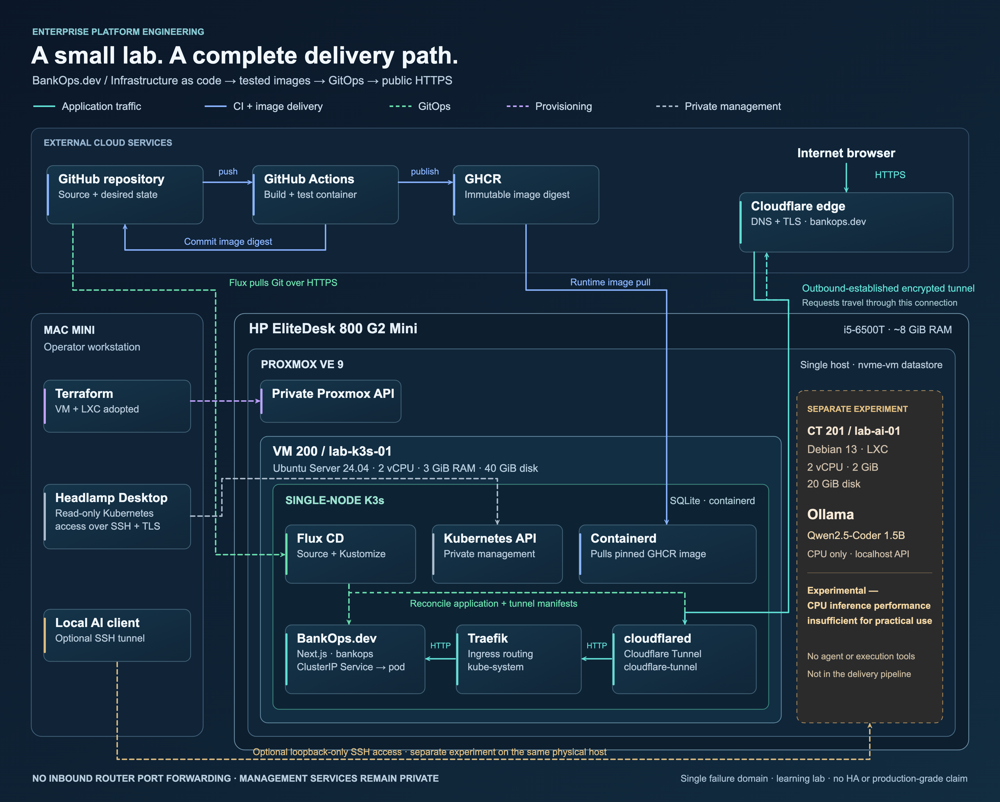

# Implemented lab architecture

[Project overview](../../README.md) · [Architecture evidence](../01-architecture.md)

## Formats

- [Mermaid source](enterprise-platform-lab.mmd): embedded in the repository README for GitHub rendering. Keep the two copies synchronized.
- [LinkedIn PNG](enterprise-platform-lab-linkedin.png): 3840 × 3080 pixels, opaque navy background, suitable for upload without exposing private addresses or credentials.
- [Editable SVG](enterprise-platform-lab.svg): vector source for the polished PNG. Text, boundaries and paths remain editable; no external font/image assets.

The diagram records the implemented architecture inspected on 2026-10-28. It groups physical hardware → Proxmox → Ubuntu VM → single-node K3s, and places the unprivileged Debian LXC beside the VM inside the same host. Mac Mini management and external cloud services are separate boundaries. The Ollama experiment shares host resources; visual separation is not a claim of network isolation or separate hardware.

## Read the flows

| Flow | Meaning |
| --- | --- |
| Teal, solid | Internet HTTPS → Cloudflare DNS/TLS edge → established tunnel → cloudflared → internal HTTP → Traefik → BankOps ClusterIP Service/pod |
| Teal, dashed return | cloudflared initiates the encrypted edge connection outbound; the request arrow does not represent an inbound forwarded router port |
| Blue | GitHub source triggers Actions; tested image publishes to GHCR; Actions commits its immutable digest; containerd pulls the pinned image |
| Green, dashed | Flux pulls Git and reconciles application/tunnel manifests; CI has no direct Kubernetes deployment credentials |
| Purple, dashed | Local Terraform manages the adopted VM/LXC resources through the private Proxmox API |
| Gray, dashed | Headlamp Desktop accesses the Kubernetes API over SSH and verified TLS with read-only RBAC |
| Amber, dashed | Optional local AI client uses an SSH loopback tunnel; no connection to the BankOps deployment pipeline |

Headlamp is a desktop client, not a dashboard deployed in K3s. Cloudflared runs in cloudflare-tunnel; Traefik in kube-system; the Next.js landing page and ClusterIP Service in bankops. Flux uses source-controller and kustomize-controller. The internal origin is HTTP; the graphic does not claim end-to-end origin TLS. Management APIs, SSH and Ollama are not published via the website tunnel. Private LAN application ingress is preserved but omitted from the social graphic for clarity. Ancillary K3s defaults (CoreDNS, Flannel, ServiceLB, metrics-server, local-path) and temporary probes are omitted.

The experimental label **“Experimental — CPU inference performance insufficient for practical use”** is the operator’s requested practical-use assessment. The repository benchmark measured approximately 12.6–12.7 generated tokens/s and approximately 5 s warm wall latency for a short fixed prompt. No new inference benchmark was run for this diagram; see [the measured results and limitations](../09-local-llm.md). The model has no agent or SSH/Git/Terraform execution tools.

This is a learning lab with one physical host, one Kubernetes node, embedded SQLite and single application/connector replicas. Neither four tunnel connections nor a rolling update makes it highly available or production-grade. No hardware, guest, router, Kubernetes manifest or workflow configuration was changed to produce these artifacts.

## Source evidence

- Physical identity: read-only /sys/class/dmi/id/product_name and sys_vendor on pve; pveversion reported 9.2.21. DMI reports HP EliteDesk 800 G2 DM 35W.
- [VM Terraform](../../terraform/environments/lab/vm.tf), [LXC Terraform](../../terraform/environments/lab/ai.tf): actual resource ownership, CPU, memory, disks and protection.
- [K3s configuration](../../kubernetes/k3s/config.yaml), [K3s operations](../07-k3s.md): single server, SQLite and networking.
- [Headlamp RBAC](../../kubernetes/headlamp/rbac.yaml), [desktop access](../08-headlamp.md): read-only API access over SSH/TLS.
- [Application workflow](../../.github/workflows/bankops-web.yml): build/test/publish and Git image-digest update; no push deployment from CI.
- [Flux source](../../clusters/lab/flux-system/gotk-sync.yaml), [application reconciliation](../../clusters/lab/bankops-sync.yaml), [connector reconciliation](../../clusters/lab/cloudflare-tunnel-sync.yaml).
- [BankOps manifests](../../deploy/bankops/), [cloudflared manifests](../../deploy/cloudflare-tunnel/), [public launch validation](../11-cloudflare-tunnel.md).

## Editing and export

For technical changes, update the .mmd source and replace the matching Mermaid block in the root README. For the polished version, edit the standalone SVG, then export it at 2× its 1920 × 1540 logical size (3840 × 3080 PNG). Chromium/Playwright can screenshot the SVG at deviceScaleFactor 2; no image-generation service, added project dependency, cloud upload, or credentials are required. The SVG and PNG depict the same architecture as Mermaid, with flow placement optimized separately for readability.
